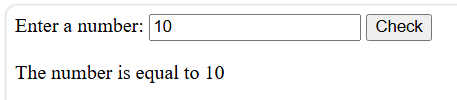
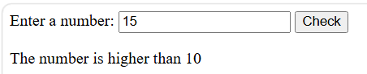
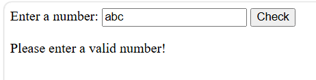
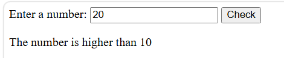
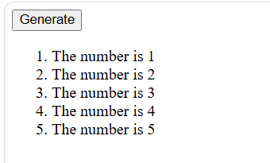

# bic21203-lab4a-javascript

BIC21203 Lab 4A JavaScript

Name : PHUNG YONG JUN

No. Matrik : CI260012

---

## Question 1

Interactive Text Changer using JavaScript functions and event listeners.

### Before Clicking Button

### After Clicking Button

---

## Question 2

Smart Number Validator using input validation and if-else statements.

### Input: 5

### Input: 10

### Input: 15

### Input: abc

### Empty Input

---

## Question 3

Dynamic Number Generator using for loops and DOM manipulation.

### Before Clicking Generate

### After Clicking Generate

---

## How to Run

### Question 1
Open index1.html in a browser.

### Question 2
Open index2.html in a browser.

### Question 3
Open index3.html in a browser.
